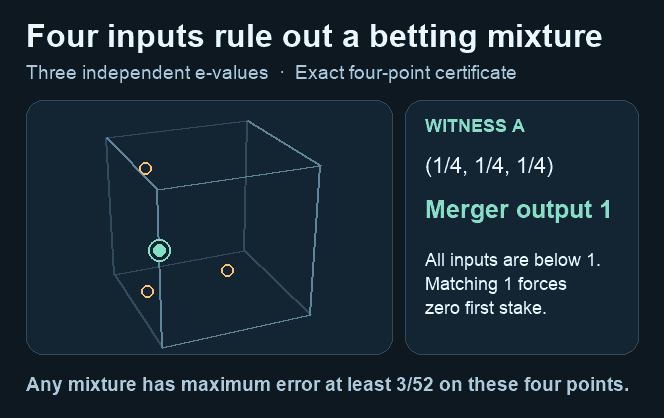

# A precise independent e-merger outside martingale mixtures

A continuous, precise merger of three independent e-values lies outside the generalized martingale mixtures of Vovk and Wang. It uses the known Lugano (Araújo–Feix/Baumeler–Wolf) Boolean selector and a continuous cutoff. Four rational inputs certify the statistical separation. [Question 4](https://pure.royalholloway.ac.uk/ws/portalfiles/portal/61949496/24-EJS2228.pdf#page=19) · [Lugano process](https://doi.org/10.1088/1367-2630/18/1/013036)

[Paper PDF](paper/manuscript.pdf) · [LaTeX source](paper/manuscript.tex) · [Catalog Q570](https://github.com/10m-u/open-problems-catalog/blob/ca8d4d44ba3db527f19f28928c240168f545ecfe/problems/computer_science_ai/classical-statistical-machine-learning.md#q570)

## Four inputs rule out a betting mixture

At the all-small point $A$, matching $F(A)=1$ requires zero first stake. For each possible first index $i$, there is a witness $B_i$ where that index is zero and the other two inputs are positive. With zero first stake, the strategy retains positive wealth even though $F(B_i)=0$. The paper shows that even approximate mixtures have maximum error at least $3/52$ on these four inputs.

[Download the offline explorer ZIP](https://raw.githubusercontent.com/DannyExperiments/precise-independent-e-merger-counterexample/v1.0.0/visualization/precise-independent-e-merger-counterexample-explorer.zip) · [Worked example and rendering guide](visualization/README.md)

## Prior work and scope

Each selector weight ignores the input it multiplies. This lets independence factor the expectation and gives precision. The merger is nonmonotone, so it addresses the precise-merger question and leaves the separate increasing restriction outside its scope. Zhang’s earlier nondomination example has no precision requirement. Ramdas and Wang’s general admissibility proposition implies that an exact merger cannot be strictly dominated by any valid independent e-merger. [Literature audit](audits/public_safe_reports/LITERATURE_AUDIT.md) · [Exact scope](CLAIM_SCOPE_AND_LIMITATIONS.md)

## Verification and citation

The [exact rational replay](REPRODUCIBILITY.md) checks the four values, the selector, sample product laws and finite betting arithmetic. The [partial Lean certificate](formal/Q570Certificate.lean) checks the finite algebra and rational inequalities. The general probabilistic argument is proved in the paper. Internally reviewed, not peer reviewed. [Research disclosure](AI_DISCLOSURE.md) · [Review status](STATUS.md)

DannyExperiments is the preferred citation identity. [Release v1.0.0](https://github.com/DannyExperiments/precise-independent-e-merger-counterexample/releases/tag/v1.0.0) · [Version DOI](https://doi.org/10.5281/zenodo.24571976) · [Citation metadata](CITATION.cff)
