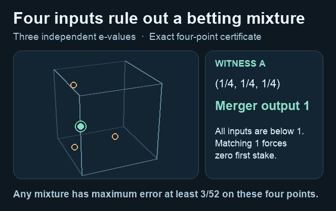

# Four inputs rule out a betting mixture

[Download the offline explorer ZIP](https://raw.githubusercontent.com/DannyExperiments/precise-independent-e-merger-counterexample/v1.0.0/visualization/precise-independent-e-merger-counterexample-explorer.zip). Extract and open `index.html`. Choose A or one of B1–B3 to inspect the exact coordinate triple and merger output at that input. The slider rotates the view of the unit cube.



At A every input is 1/4 and the merger returns one. At B1, B2 and B3 one coordinate vanishes and the merger copies the zero. A strategy that reads the zero coordinate first without betting on it retains positive wealth through both remaining reads. The [paper](../paper/manuscript.pdf) proves the quantitative bound and the expectation statement for all independent e-variables.

The browser view requires no external libraries or network. To reproduce the GIF, use an existing Python environment with Pillow and Arial or DejaVu Sans.

```sh
python3 visualization/render.py
```
